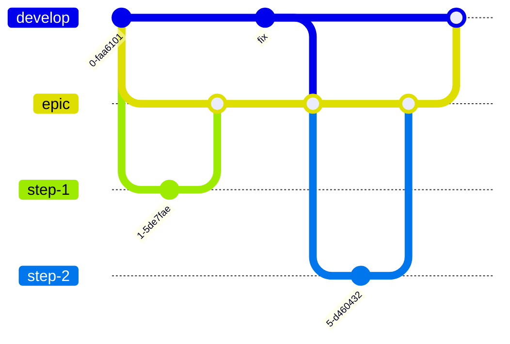

# Ramas

De qué rama parte el trabajo y hacia dónde va su pull request.

## Ramas de larga duración

| Rama | Papel |
|---|---|
| `main` | Versiones publicadas. Solo se mergean en ella las ramas `release/X.X.X` (ver [Release](release.md)). |
| `develop` | Rama de integración: la próxima versión, siempre con los tests en verde. |
| `epic/<nombre>` | Un esfuerzo grande formado por varios cambios que no deben llegar a `develop` uno a uno (ver más abajo). |

## Ramas de trabajo

Cada cambio se hace en su propia rama de corta duración, nombrada según su tipo: `feature/`, `fix/`, `chore/`, `docs/`. Parte de `develop` y vuelve a `develop` mediante una pull request.

Los cambios no triviales se planifican con OpenSpec antes de implementarse (ver [OpenSpec](openspec.md)).

## Ramas épicas

Algunos esfuerzos abarcan varios cambios cuyos estados intermedios no deben llegar a `develop`, por ejemplo una reestructuración que solo tiene sentido cuando están hechos varios pasos. Se desarrollan en una rama épica, para que mientras tanto `develop` siga libre para mantenimiento y releases.

1. **Crear** `epic/<nombre>` desde `develop`.
2. **Cada paso** es una rama de trabajo creada desde la rama épica, con su pull request hacia la rama épica. Cada paso se sigue planificando con su propio cambio de OpenSpec.
3. **Mantenerla al día**: mergear `develop` en la rama épica con regularidad, y siempre antes de mergear la épica de vuelta. Con merge, no con rebase, porque la rama es compartida y ya está subida.
4. **Cerrarla** con una pull request de la rama épica a `develop`, cuando el esfuerzo (o una parte estable y autocontenida de él) esté terminado.

El workflow `Tests` corre en cada pull request hacia una rama `epic/**`, igual que para `develop`, y de nuevo en la pull request del epic hacia `develop` mientras está abierta. Los push a la rama del epic no lo disparan, así que cada commit se prueba una sola vez, en su pull request. Para probar la rama del epic por sí sola, por ejemplo tras mergear `develop` en ella antes de que exista su pull request, lanza el workflow a mano desde la pestaña Actions (`workflow_dispatch`).
