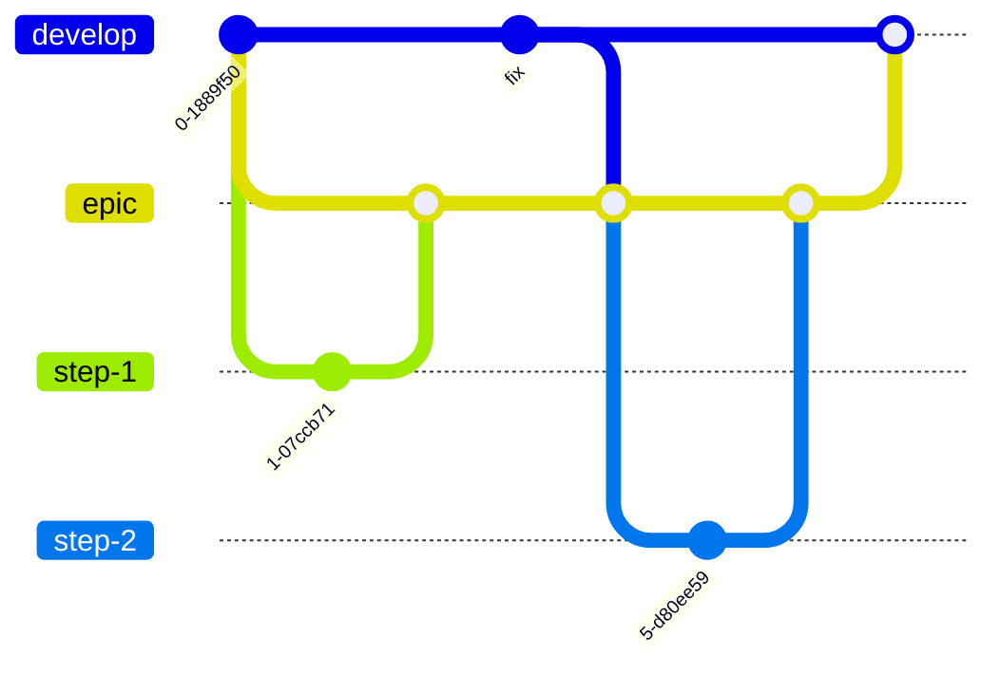

# Branches

Which branch work starts from and where its pull request goes.

## Long-lived branches

| Branch | Role |
|---|---|
| `main` | Published versions. Only `release/X.X.X` branches are merged into it (see [Release](release.md)). |
| `develop` | Integration branch: the next version, always passing the tests. |
| `epic/<name>` | A large effort made of several changes that shouldn't reach `develop` one by one (see below). |

## Work branches

Each change is done in its own short-lived branch, named by its kind: `feature/`, `fix/`, `chore/`, `docs/`. It starts from `develop` and goes back to `develop` through a pull request.

Non-trivial changes are planned with OpenSpec before being implemented (see [OpenSpec](openspec.md)).

## Epic branches

Some efforts span several changes whose intermediate states shouldn't reach `develop`, for example a restructuring that only makes sense once several steps are done. They're developed on an epic branch, so `develop` stays free for maintenance and releases in the meantime.

1. **Create** `epic/<name>` from `develop`.
2. **Each step** is a work branch created from the epic branch, with its pull request targeting the epic branch. Each step is still planned with its own OpenSpec change.
3. **Keep it up to date**: merge `develop` into the epic branch regularly, and always before merging the epic back. Use a merge, not a rebase, because the branch is shared and already pushed.
4. **Close it** with a pull request from the epic branch to `develop`, once the effort (or a stable, self-contained part of it) is done.

The `Tests` workflow runs on every pull request targeting an `epic/**` branch, the same as for `develop`, and again on the epic's pull request to `develop` while it's open. Pushes to the epic branch don't trigger it, so each commit is tested once, by its pull request. To test the epic branch on its own, for example after merging `develop` into it before its pull request exists, run the workflow by hand from the Actions tab (`workflow_dispatch`).
