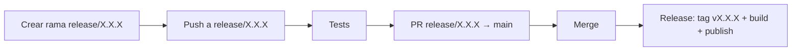

# Proceso de release

Cómo se corta y publica una nueva versión del instalador de escritorio (`.dmg`/`.msi`/`.deb`).

## Flujo



1. **Crear la rama** `release/X.X.X` (donde `X.X.X` es la versión a publicar) desde `main`.
2. **Validar** — cada push a `release/**` dispara el workflow `Tests` (`.github/workflows/tests.yml`), que corre `./gradlew test`. Sirve para iterar y corregir antes de abrir la PR. El mismo workflow corre también en cada pull request hacia `develop` o una rama `epic/**` y en cada push a ellas, así que las regresiones se detectan antes de llegar a una rama de release.
3. **Abrir la PR** de `release/X.X.X` a `main` y revisarla como cualquier otra.
4. **Mergear** — al mergearse una PR cuya rama de origen matchea `release/*`, el workflow `Release` (`.github/workflows/release.yml`):
      1. crea y pushea el tag `vX.X.X` sobre el commit de merge (la versión sale del nombre de la rama, no hay que escribirla dos veces),
      2. crea el GitHub Release en modo **draft** con las notas autogeneradas (una sola vez, antes de compilar),
      3. compila los instaladores en macOS Apple Silicon, macOS Intel, Windows y Linux (`packageReleaseDmg`/`Msi`/`Deb`) pasando esa versión y sube cada uno como asset de esa release, que se mantiene en draft mientras dura la subida en paralelo. Cada `.dmg` de macOS recibe su sufijo de arquitectura (`-arm64`/`-x64`) justo después del build, tomado de la arquitectura del propio runner,
      4. una vez subidos los cuatro instaladores, publica la release (saca el draft),
      5. regenera el Cask de Homebrew a partir de `.github/homebrew/shogunai.rb` con la nueva versión y el `sha256` de ambos `.dmg`, y lo pushea al tap `LuxionServer/homebrew-shogunai`.

Todo el paso 4 ocurre en un único run de CI, sin intervención manual. La release se crea en draft y recién se publica al final porque una release ya publicada es inmutable para GitHub (rechaza nuevos assets) y porque generar las notas una sola vez evita que se dupliquen si cada build del matrix las regenerara por su cuenta.

## Versión del instalador

`compose.desktop.application.nativeDistributions.packageVersion` (en `desktopApp/build.gradle.kts`) lee la propiedad de Gradle `appVersion`:

```kotlin
packageVersion = (findProperty("appVersion") as String?) ?: "0.0.0"
```

- En CI siempre se pasa `-PappVersion=X.X.X` (extraído del tag o del nombre de la rama `release/X.X.X`), así que el instalador publicado siempre coincide con el tag.
- En builds locales (sin esa propiedad) cae al default `0.0.0`, que es también la versión que muestra la app (`BuildInfo.VERSION`, generado por la tarea `generateBuildInfo`, que se vuelve a ejecutar cada vez que cambia `appVersion`).
- jpackage exige versiones estrictamente numéricas (`MAJOR.MINOR.PATCH`), no acepta sufijos como `-dev`. En macOS además el primer número tiene que ser mayor que cero, así que empaquetar en local (`packageDmg`, `createDistributable`) necesita una versión explícita, p. ej. `./gradlew :desktopApp:packageDmg -PappVersion=1.0.0`; `./gradlew :desktopApp:run` funciona con el default.

## Vía manual (escape hatch)

El workflow `Release` también se dispara con un push de tag directo (`git tag vX.X.X && git push origin vX.X.X`), sin pasar por una rama `release/`. Útil para hotfixes puntuales, pero el flujo normal es el de ramas `release/*` descrito arriba.

## Por qué el tag no dispara el workflow por sí solo en el caso del merge

Si el job de merge pusheara el tag usando el `GITHUB_TOKEN` por defecto, GitHub **no** dispararía el `on: push: tags` del mismo workflow (restricción para evitar loops). Por eso el build y la publicación no dependen de ese re-trigger: corren en el mismo run que crea el tag, usando `needs` entre jobs.
