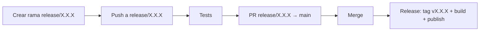

# Proceso de release

Cómo se corta y publica una nueva versión del instalador de escritorio (`.dmg`/`.msi`/`.deb`).

## Flujo



1. **Crear la rama** `release/X.X.X` (donde `X.X.X` es la versión a publicar) desde `develop`, y escribir la feature principal de la release en `.github/release-title` (ver [Título de la release](#título-de-la-release)).
2. **Validar** — cada push a `release/**` dispara el workflow `Tests` (`.github/workflows/tests.yml`), que corre `./gradlew test`. Sirve para iterar y corregir antes de abrir la PR. El mismo workflow corre también en cada pull request hacia `develop` o una rama `epic/**` y en cada push a ellas, así que las regresiones se detectan antes de llegar a una rama de release.
3. **Abrir la PR** de `release/X.X.X` a `main` y revisarla como cualquier otra.
4. **Mergear** — al mergearse una PR cuya rama de origen matchea `release/*`, el workflow `Release` (`.github/workflows/release.yml`):
      1. valida la versión tomada del nombre de la rama (o del tag): debe ser `X.Y.Z` solo con dígitos; si no, el run falla antes de compilar nada,
      2. ejecuta la suite completa de tests sobre el commit de la release en Linux, macOS y Windows (`.github/workflows/test-suite.yml`, el mismo que usa `Tests`). Nada más corre hasta que pasa,
      3. crea y pushea el tag `vX.X.X` sobre el commit de merge (la versión sale del nombre de la rama, no hay que escribirla dos veces) y crea el GitHub Release en modo **draft** con las notas autogeneradas y el título `vX.X.X — <feature>` (la feature se lee de `.github/release-title`, ver [Título de la release](#título-de-la-release)); una sola vez, antes de compilar,
      4. compila los instaladores en macOS Apple Silicon, macOS Intel, Windows y Linux (`packageReleaseDmg`/`Msi`/`Deb`) pasando esa versión, con un token de solo lectura. Cada `.dmg` de macOS se renombra `ShogunAi-X.X.X-<arch>.dmg` (`arm64`/`x64`, tomado de la arquitectura del propio runner) justo después del build, y cada instalador se guarda como artefacto del workflow,
      5. en paralelo, compila una vez en Linux la herramienta de línea de comandos independiente (`:cli:distZip`, ver [Línea de comandos](../architecture/cli.md)) y guarda `shogun-X.X.X.zip` como artefacto,
      6. una vez compilados los cuatro instaladores y el zip, el único job con permiso de escritura en el repositorio genera `SHA256SUMS` con el checksum de cada asset, lo sube todo al draft y publica la release (saca el draft),
      7. regenera el Cask de Homebrew a partir de `.github/homebrew/shogunai.rb` con la nueva versión y los checksums de los `.dmg` leídos de `SHA256SUMS`, y lo pushea al tap `LuxionServer/homebrew-shogunai`. El Cask instala la app y enlaza su lanzador como el comando `shogun`,
      8. regenera `bucket/shogunai.json` en el bucket `LuxionServer/scoop-shogunai` a partir de `.github/scoop/shogunai.json` con la nueva versión y el checksum del `.msi` leído de `SHA256SUMS`, y lo pushea,
      9. abre un pull request a `microsoft/winget-pkgs` que actualiza `LuxionServer.ShogunAi` al nuevo `.msi` (acción `winget-releaser`).

Los pasos 7, 8 y 9 se ejecutan en paralelo y son independientes: si uno falla, la release sigue publicada y los demás se ejecutan igualmente.

Todo el flujo desde el paso 4 ocurre en un único run de CI, sin intervención manual. La release se crea en draft y recién se publica al final porque una release ya publicada es inmutable para GitHub (rechaza nuevos assets) y porque generar las notas una sola vez evita que se dupliquen si cada build del matrix las regenerara por su cuenta.

## Título de la release

Cada release lee su título de `.github/release-title`: la primera línea de ese fichero es la feature principal, y el workflow titula la release `vX.X.X — <feature>`. Por ejemplo, si la 0.9.0 trae soporte multirepo, se publica como `v0.9.0 — Multi-repo support`.

Escríbelo al crear la rama de release, en el mismo commit que sube la versión. Si el fichero está vacío o falta, el workflow vuelve al título simple `vX.X.X` y registra un warning, así que un título olvidado nunca bloquea una release — pero siempre merece una entrada en las notas de la release.

## Gestores de paquetes de Windows

Preparación única por parte del mantenedor, antes de la primera release que ejecute los pasos 8 y 9 (hasta entonces esos jobs fallan sin afectar a la release):

1. Crear el repositorio público `LuxionServer/scoop-shogunai` con una carpeta `bucket/` y un README con los comandos de instalación.
2. Crear un token fine-grained con `Contents: read and write` solo sobre ese repositorio y guardarlo como secreto `SCOOP_BUCKET_TOKEN`.
3. Enviar a mano la primera versión a winget con `wingetcreate new https://github.com/LuxionServer/ShogunAi/releases/download/v<versión>/ShogunAi-<versión>.msi`, con el identificador `LuxionServer.ShogunAi`, y esperar a que se fusione (la acción solo puede actualizar un paquete existente).
4. Crear un token clásico con `public_repo` y guardarlo como secreto `WINGET_TOKEN`.

El `.msi` declara un código de actualización fijo (`upgradeUuid` en `desktopApp/build.gradle.kts`), así que un `.msi` más nuevo reemplaza la versión instalada; no lo cambies. jpackage elimina `java.exe` del runtime incluido, así que `desktopApp/build.gradle.kts` lo copia de vuelta desde el JDK de la compilación tras `createRuntimeImage`: el comando `shogun` de Scoop lo ejecuta.

Tras actualizar Compose Desktop o jpackage, comprueba en Windows que la estructura del `.msi` sigue coincidiendo con el manifiesto de Scoop: instala desde el manifiesto renderizado (`scoop install` con una copia local de `.github/scoop/shogunai.json` con la versión y el `sha256` rellenados) y ejecuta `shogun --version`.

## Checksums de la release

Cada release incluye un archivo `SHA256SUMS`. Para verificar una descarga: `shasum -a 256 -c SHA256SUMS --ignore-missing`.

## Acciones fijadas

Las acciones ajenas a `actions/*` y `gradle/*` se referencian por SHA de commit, porque reciben secretos. Dependabot (`.github/dependabot.yml`) propone actualizaciones cada semana.

| Acción | Tag | Commit |
|---|---|---|
| `vedantmgoyal9/winget-releaser` | `v2` | `b7370d4d152efdce803a26cc6ca9eee58cb2ad54` |

## Versión del instalador

`compose.desktop.application.nativeDistributions.packageVersion` (en `desktopApp/build.gradle.kts`) lee la propiedad de Gradle `appVersion`:

```kotlin
packageVersion = (findProperty("appVersion") as String?) ?: "0.0.0"
```

- En CI siempre se pasa `-PappVersion=X.X.X` (extraído del tag o del nombre de la rama `release/X.X.X`), así que el instalador publicado siempre coincide con el tag.
- En builds locales (sin esa propiedad) cae al default `0.0.0`, que es también la versión que muestra la app (`BuildInfo.VERSION`, generado por la tarea `generateBuildInfo`, que se vuelve a ejecutar cada vez que cambia `appVersion`).
- La versión del bundle de macOS se deriva de ella con una única regla, `macBundleVersion` en `desktopApp/build.gradle.kts`: mayor + 1 (`0.9.0` → `1.9.0`, `1.4.0` → `2.4.0`). Siempre es válida para macOS, crece con la versión de la release y nunca colisiona. Los `.dmg` se nombran con la versión de la release, nunca con la del bundle.
- jpackage exige versiones estrictamente numéricas (`MAJOR.MINOR.PATCH`), no acepta sufijos como `-dev`. En macOS además el primer número tiene que ser mayor que cero, así que empaquetar en local (`packageDmg`, `createDistributable`) necesita una versión explícita, p. ej. `./gradlew :desktopApp:packageDmg -PappVersion=1.0.0`; `./gradlew :desktopApp:run` funciona con el default.

## Vía manual (escape hatch)

El workflow `Release` también se dispara con un push de tag directo (`git tag vX.X.X && git push origin vX.X.X`), sin pasar por una rama `release/`. Útil para hotfixes puntuales, pero el flujo normal es el de ramas `release/*` descrito arriba.

## Por qué el tag no dispara el workflow por sí solo en el caso del merge

Si el job de merge pusheara el tag usando el `GITHUB_TOKEN` por defecto, GitHub **no** dispararía el `on: push: tags` del mismo workflow (restricción para evitar loops). Por eso el build y la publicación no dependen de ese re-trigger: corren en el mismo run que crea el tag, usando `needs` entre jobs.
