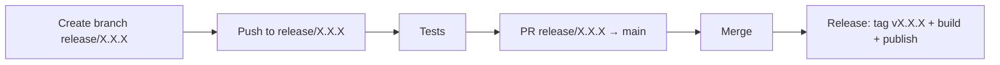

# Release process

How a new version of the desktop installer (`.dmg`/`.msi`/`.deb`) is cut and published.

## Flow



1. **Create the branch** `release/X.X.X` (where `X.X.X` is the version to publish) from `develop`.
2. **Validate** — every push to `release/**` triggers the `Tests` workflow (`.github/workflows/tests.yml`), which runs `./gradlew test`. Used to iterate and fix issues before opening the PR. The same workflow also runs on every pull request targeting `develop` or an `epic/**` branch and every push to them, so regressions are caught before they reach a release branch.
3. **Open the PR** from `release/X.X.X` to `main` and review it like any other.
4. **Merge** — when a PR whose source branch matches `release/*` is merged, the `Release` workflow (`.github/workflows/release.yml`):
      1. validates the version taken from the branch name (or the tag): it must be `X.Y.Z` with digits only, otherwise the run fails before building anything,
      2. runs the full test suite on the release commit on Linux, macOS and Windows (`.github/workflows/test-suite.yml`, the same one `Tests` uses). Nothing else runs until it passes,
      3. creates and pushes the `vX.X.X` tag on the merge commit (the version comes from the branch name, no need to write it twice) and creates the GitHub Release in **draft** mode with auto-generated notes (only once, before building),
      4. builds the installers on macOS Apple Silicon, macOS Intel, Windows and Linux (`packageReleaseDmg`/`Msi`/`Deb`) passing that version, with a read-only token. Each macOS `.dmg` is renamed `ShogunAi-X.X.X-<arch>.dmg` (`arm64`/`x64`, taken from the runner's own architecture) right after the build, and each installer is kept as a workflow artifact,
      5. in parallel, builds the standalone command-line tool once on Linux (`:cli:distZip`, see [Command-line tool](../architecture/cli.md)) and keeps `shogun-X.X.X.zip` as an artifact,
      6. once all four installers and the zip are built, the only job that writes to the repository writes `SHA256SUMS` with the checksum of every asset, uploads everything to the draft and publishes the release (takes it out of draft),
      7. regenerates the Homebrew Cask from `.github/homebrew/shogunai.rb` with the new version and the `.dmg` checksums read from `SHA256SUMS`, and pushes it to the `LuxionServer/homebrew-shogunai` tap. The Cask installs the app and links its launcher as the `shogun` command,
      8. regenerates `bucket/shogunai.json` in the `LuxionServer/scoop-shogunai` bucket from `.github/scoop/shogunai.json` with the new version and the `.msi` checksum read from `SHA256SUMS`, and pushes it,
      9. opens a pull request to `microsoft/winget-pkgs` updating `LuxionServer.ShogunAi` to the new `.msi` (`winget-releaser` action).

Steps 7, 8 and 9 run in parallel and are independent: if one fails, the release stays published and the others still run.

The whole flow from step 4 happens in a single CI run, with no manual intervention. The release is created as a draft and only published at the end because an already-published release is immutable for GitHub (it rejects new assets), and because generating the notes only once avoids duplicates if each matrix build regenerated them on its own.

## Windows package managers

One-time setup by the maintainer, before the first release that runs steps 8 and 9 (until it's done, those jobs fail without affecting the release):

1. Create the public repository `LuxionServer/scoop-shogunai` with a `bucket/` folder and a README with the install commands.
2. Create a fine-grained token with `Contents: read and write` on that repository only and store it as the `SCOOP_BUCKET_TOKEN` secret.
3. Submit the first winget version by hand with `wingetcreate new https://github.com/LuxionServer/ShogunAi/releases/download/v<version>/ShogunAi-<version>.msi`, using the identifier `LuxionServer.ShogunAi`, and wait for it to be merged (the action can only update an existing package).
4. Create a classic token with `public_repo` and store it as the `WINGET_TOKEN` secret.

The `.msi` declares a fixed upgrade code (`upgradeUuid` in `desktopApp/build.gradle.kts`), so a newer `.msi` replaces the installed version; don't change it. jpackage strips `java.exe` from the bundled runtime, so `desktopApp/build.gradle.kts` copies it back from the build JDK after `createRuntimeImage`: the Scoop `shogun` command runs it.

After a Compose Desktop or jpackage upgrade, check on Windows that the `.msi` layout still matches the Scoop manifest: install from the rendered manifest (`scoop install` with a local copy of `.github/scoop/shogunai.json` with the version and `sha256` filled in) and run `shogun --version`.

## Release checksums

Every release includes a `SHA256SUMS` file. To verify a download: `shasum -a 256 -c SHA256SUMS --ignore-missing`.

## Pinned actions

Actions outside `actions/*` and `gradle/*` are referenced by commit SHA, because they receive secrets. Dependabot (`.github/dependabot.yml`) proposes updates weekly.

| Action | Tag | Commit |
|---|---|---|
| `vedantmgoyal9/winget-releaser` | `v2` | `b7370d4d152efdce803a26cc6ca9eee58cb2ad54` |

## Installer version

`compose.desktop.application.nativeDistributions.packageVersion` (in `desktopApp/build.gradle.kts`) reads the Gradle property `appVersion`:

```kotlin
packageVersion = (findProperty("appVersion") as String?) ?: "0.0.0"
```

- In CI, `-PappVersion=X.X.X` (extracted from the tag or the `release/X.X.X` branch name) is always passed, so the published installer always matches the tag.
- In local builds (without that property) it falls back to the default `0.0.0`, which is also the version shown in the app (`BuildInfo.VERSION`, generated by the `generateBuildInfo` task, which reruns whenever `appVersion` changes).
- The macOS bundle version is derived from it by one rule, `macBundleVersion` in `desktopApp/build.gradle.kts`: major + 1 (`0.9.0` → `1.9.0`, `1.4.0` → `2.4.0`). It is always valid for macOS, increases with the release version and never collides. The `.dmg` files are named after the release version, never the bundle version.
- jpackage requires strictly numeric versions (`MAJOR.MINOR.PATCH`), it doesn't accept suffixes like `-dev`. On macOS the first number must also be greater than zero, so packaging locally (`packageDmg`, `createDistributable`) needs an explicit version, e.g. `./gradlew :desktopApp:packageDmg -PappVersion=1.0.0`; `./gradlew :desktopApp:run` works with the default.

## Manual path (escape hatch)

The `Release` workflow is also triggered by a direct tag push (`git tag vX.X.X && git push origin vX.X.X`), without going through a `release/` branch. Useful for one-off hotfixes, but the normal flow is the `release/*` branch flow described above.

## Why the tag doesn't trigger the workflow on its own in the merge case

If the merge job pushed the tag using the default `GITHUB_TOKEN`, GitHub would **not** trigger the same workflow's `on: push: tags` (a restriction to prevent loops). That's why the build and publish don't depend on that re-trigger: they run in the same run that creates the tag, using `needs` between jobs.
