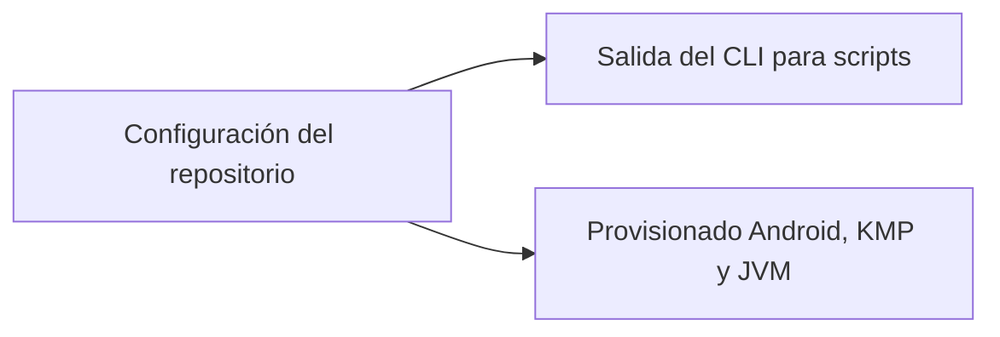

# Roadmap

Ideas aceptadas para el futuro de ShogunAi, agrupadas por tema. Esta página marca una dirección, no un compromiso de fechas: cada punto se convierte en un cambio de OpenSpec (`/opsx:propose`) cuando se aborda, y su diseño se decide allí. Cuando un cambio se archiva, su punto se elimina de esta página.

## Dirección

ShogunAi está evolucionando de una app de escritorio que crea worktrees a **la capa de worktrees para cualquier agente de IA**: prepara cada worktree para que esté listo para compilar y te da una vista de todos ellos, los haya creado quien los haya creado. No incrusta terminales ni ejecuta agentes; Claude, Codex o cualquier otro agente lo sigue haciendo, dentro de los worktrees que ShogunAi prepara y supervisa.

Esa dirección se construye en tres capas:

| Capa | Papel | Qué aporta |
|---|---|---|
| **Motor y CLI** | La base | Provisionado de worktrees definido en el repositorio (`.shogunai.json`) y un comando `shogun` que usan la app de escritorio, los agentes y sus hooks, con un entorno por worktree (puertos reservados y variables) que llega a la shell de cada agente. **Disponible**; el provisionado más completo está planificado. |
| **Torre de control** | La vista | La app de escritorio muestra el estado de todos los worktrees, incluidos los creados por otras herramientas, los mantiene limpios y sigue los cambios según ocurren. **Disponible.** |
| **Android, KMP y JVM** | El contenido | Provisionado para los stacks en los que más cuesta preparar un worktree: Gradle, secretos locales, emuladores e IDEs. **Empezado**: los repositorios Gradle muestran sus daemons, pueden parar los ociosos y acotar la memoria y la vida de los daemons que arrancan los agentes, los repositorios Android pueden dar a cada worktree su propio emulador, los KMP e iOS su propio simulador de iOS, y los repositorios Xcode ven y limpian sus DerivedData y comparten compilaciones entre worktrees. |

## Planificado

### Rediseño de la app de escritorio

En curso en la rama `epic/ui-redesign`. La app de escritorio ha crecido funcionalidad a funcionalidad sin un diseño: un proyecto cada vez, filas de worktree abarrotadas, los recursos de la máquina al final de la lista de un proyecto y errores mostrados como la salida en crudo de un comando. El rediseño la convierte en una torre de control organizada en tres paneles:

- **Barra lateral**: "Activos" (la vista principal: los worktrees con un agente trabajando, trabajo esperándote o todavía en curso, de todos los proyectos), "Todos los worktrees" (todos los proyectos; al elegir un proyecto se filtra la vista), los proyectos, y una sección "Máquina" con los daemons de Gradle, los emuladores de Android, los simuladores de iOS y los DerivedData de Xcode de todos los proyectos.
- **Lista**: una línea por worktree, con la rama como etiqueta e indicadores compactos para lo que importa.
- **Detalle**: todo sobre el worktree seleccionado y sus acciones.

Está planificado en estos cambios de OpenSpec, que se implementan en este orden:

1. `app-shell-layout`: la ventana con barra lateral, menú de la aplicación, Preferencias y Acerca de, en lugar de la pantalla de lista de proyectos.
2. `create-worktree-dialog`: crear un worktree en un diálogo (Cmd/Ctrl+N) que después ofrece copiar el comando de lanzamiento.
3. `worktree-list-detail`: filas de una línea y un panel de detalle, con la configuración del proyecto accesible desde su vista.
4. `all-worktrees-view`: los worktrees de todos los proyectos en una vista, con filtros por proyecto y por texto.
5. `active-worktrees-view`: la vista "Activos", la agrupación por estado y los contadores de actividad en la barra lateral.
6. `machine-resources-view`: la sección "Máquina", que sustituye a las secciones de Gradle y DerivedData de la vista del proyecto.
7. `project-settings-view`: la configuración del proyecto en secciones con una barra de guardado, y añadir un proyecto a partir de la carpeta de su repositorio.
8. `providers-configuration`: activar los providers, fijar sus opciones y el entorno por worktree desde la configuración, escribiendo `.shogunai.json`.
9. `understandable-errors`: cada error dice qué ha fallado y qué hacer después, con la salida técnica guardada en "Detalles técnicos".
10. `command-palette`: Cmd/Ctrl+K para saltar a cualquier vista, proyecto o worktree, o ejecutar una acción.

Cada cambio quita su línea de esta lista cuando se archiva.

### Demo guiada de bienvenida

Un recorrido de primer uso basado en la revisión hecha antes de mergear la capa de worktrees: la app crea un repositorio de ejemplo desechable con worktrees en todos los estados y abre un agente con un prompt preparado que guía al usuario por cada funcionalidad (estado, limpieza, provisionado, el CLI, los hooks, el entorno y los providers), paso a paso.

### Configuración del repositorio

Provisionado más completo en el `.shogunai.json` del repositorio:

- Un hook post-creación ejecutado como argv (p. ej. `npm install`, `direnv allow`).
- Enlazar un secreto con un symlink en vez de copiarlo, para que al rotarlo se actualice en todos los worktrees.
- Detectar secretos de un worktree que difieren de los del repositorio base.

### Salida del CLI para scripts

- Una salida legible por máquinas (`--json`) para los comandos de `shogun` que necesiten los scripts, empezando por `status`.

### Provisionado Android, KMP y JVM

Provisionado para los stacks en los que un worktree recién creado está más lejos de compilar:

- `local.properties`, keystores y `google-services.json`.
- «Abrir en Android Studio» en el worktree correcto.
- Mostrar los emuladores que arranca ShogunAi dentro de la ventana Running Devices de Android Studio, como los que arranca el propio Android Studio, para poder ordenar varios en una sola ventana. Necesita un spike: Android Studio podría incrustar un emulador externo arrancado con las mismas opciones que usa él.

### Elegir la base de un worktree nuevo

Hoy una rama nueva parte del `HEAD` del repositorio base, así que crear un worktree desde una rama actualizada obliga a pasar antes por otro cliente de Git. En su lugar:

- Elegir la rama base (`develop`, `main`, …) al crear un worktree, con un `git fetch` previo opcional.
- Crear un worktree desde una rama remota (`origin/...`), no solo desde las locales.

### Lanzar el agente y las herramientas directamente

Copiar el comando de lanzamiento sigue siendo la opción por defecto, pero la app también podría abrirlo directamente con integraciones concretas y fiables en lugar de un lanzamiento genérico de terminal:

- Terminales: iTerm2 y Terminal en macOS, Windows Terminal, tmux y Zellij.
- «Abrir en IDE» (VS Code, IntelliJ IDEA, Android Studio) y «Abrir carpeta».

### Modo multiagente

Hay quien alterna entre agentes de IA en una misma tarea, por ejemplo cuando a uno se le agota la cuota. Un proyecto guardaría varios comandos de agente en vez de uno (Claude, Antigravity, Codex, …), cada uno con sus argumentos por defecto, y el usuario elegiría el agente al copiar o lanzar el comando. La configuración actual de un solo agente sigue siendo la opción por defecto para quien no lo necesite.

### Ergonomía de escritorio

- Icono en la barra de menús / bandeja del sistema con los proyectos y worktrees recientes.

### Distribución

- Comprobación de actualizaciones contra GitHub Releases: la app detecta una versión nueva y ofrece descargarla (o indica `brew upgrade` si se instaló con Homebrew).
- Gestores de paquetes de Windows: publicar en winget y Scoop junto al `.msi`.

## En estudio

### Integración con GitHub y gestores de tareas

Crear un worktree desde un issue de GitHub o una tarea de un gestor (derivando el id y el título de la tarea) y mostrar el estado del pull request de cada rama (abierto, en revisión, CI en rojo, mergeado). El valor está claro, pero el modelo de integración todavía no: qué proveedores, cómo autenticarse y cuánto depender de CLIs externas como `gh`. Hay que pensarlo más antes de convertirlo en un cambio.

## Fuera de alcance por ahora

### Ejecutar agentes dentro de la app

ShogunAi no incrusta terminales ni gestiona sesiones de agentes: los agentes y los terminales ya lo hacen bien. Se centra en los worktrees en los que trabajan.

### Firma y notarización en macOS

Queda fuera por ahora: requiere el programa de desarrollador de Apple, que es de pago. Mientras tanto, el README explica cómo abrir la app sin notarizar.
