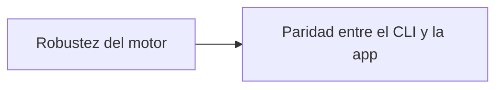

# Roadmap

Ideas aceptadas para el futuro de ShogunAi, agrupadas por tema. Esta página marca una dirección, no un compromiso de fechas: cada punto se convierte en un cambio de OpenSpec (`/opsx:propose`) cuando se aborda, y su diseño se decide allí. Cuando un cambio se archiva, su punto se elimina de esta página.

## Dirección

ShogunAi está evolucionando de una app de escritorio que crea worktrees a **la capa de worktrees para cualquier agente de IA**: prepara cada worktree para que esté listo para compilar y te da una vista de todos ellos, los haya creado quien los haya creado. No incrusta terminales ni ejecuta agentes; Claude, Codex o cualquier otro agente lo sigue haciendo, dentro de los worktrees que ShogunAi prepara y supervisa.

Esa dirección se construye en tres capas:

| Capa | Papel | Qué aporta |
|---|---|---|
| **Motor y CLI** | La base | Provisionado de worktrees definido en el repositorio (`.shogunai.json`) y un comando `shogun` que usan la app de escritorio, los agentes y sus hooks, con un entorno por worktree (puertos reservados y variables) que llega a la shell de cada agente. **Disponible.** |
| **Torre de control** | La vista | La app de escritorio muestra el estado de todos los worktrees, incluidos los creados por otras herramientas, los mantiene limpios y sigue los cambios según ocurren. **Disponible.** |
| **Android, KMP y JVM** | El contenido | Provisionado para los stacks en los que más cuesta preparar un worktree: Gradle, secretos locales, emuladores e IDEs. **Empezado**: los repositorios Gradle muestran sus daemons, pueden parar los ociosos y acotar la memoria y la vida de los daemons que arrancan los agentes, los repositorios Android pueden dar a cada worktree su propio emulador, los KMP e iOS su propio simulador de iOS, y los repositorios Xcode ven y limpian sus DerivedData y comparten compilaciones entre worktrees. |

Se conecta con las herramientas que ejecutan agentes en vez de sustituirlas: los hooks de worktree y de sesión de Claude Code, y [Herdr](https://herdr.dev), el multiplexor de terminal para agentes, cuyos worktrees provisiona un plugin de ShogunAi y en el que la app de escritorio abre un worktree con su entorno y su agente. **Disponible.**

## Planificado

### Endurecimiento tras el uso real

Una revisión de todo el proyecto el 2026-10-19, tras usarlo en repositorios reales, se convirtió en seis cambios de OpenSpec, ya propuestos en `openspec/changes/`:

- **Robustez del motor** (`process-robustness`): los comandos cancelados se detienen, ningún comando espera entrada, una creación fallida borra su rama, los ficheros locales corruptos se notifican y se conservan, los submódulos funcionan y las ramas se borran con una misma regla en todas partes; la limpieza nunca borra un worktree con un agente en marcha.
- **Correcciones de escritorio tras el rediseño** (`desktop-review-fixes`): sin crash cuando una creación coincide con un refresco, errores visibles en cualquier agrupación, errores dentro del diálogo de borrado y edición de la ruta en ajustes sin perder cambios sin guardar.
- **Coste del refresco en segundo plano** (`background-refresh-cost`): el watcher se pausa con la ventana en segundo plano y solo comprueba los proyectos mostrados, con lecturas de dispositivos más baratas (hecho).
- **Paridad entre el CLI y la app** (`cli-desktop-parity`): `shogun remove` y `shogun repair`, y en la app el estado de provisionado y «Provisionar» para worktrees creados por otras herramientas, además de las variables de entorno del worktree.
- **Higiene de documentación y build** (`docs-hygiene`): documentación que faltaba, el test del manifiesto del plugin de Herdr, avisos del compilador, strings y dependencias sin usar, y reglas de ignore.

Pendientes que quedan fuera de esos cambios:

- Soporte de repositorios bare con worktrees (el esquema «bare clone»), que cambia lo que significan el repositorio base y copiar desde él.
- Watchers del sistema de ficheros en vez de polling para los cambios de metadatos de Git.
- Dividir `ProjectWorktrees.kt` y `ProjectSettingsView.kt` en holders y secciones más pequeños.
- Atestaciones de procedencia del build para los artefactos de release, y tratar los avisos del compilador como errores cuando el build esté limpio.

### Demo guiada de bienvenida

Un recorrido de primer uso basado en la revisión hecha antes de mergear la capa de worktrees: la app crea un repositorio de ejemplo desechable con worktrees en todos los estados y abre un agente con un prompt preparado que guía al usuario por cada funcionalidad (estado, limpieza, provisionado, el CLI, los hooks, el entorno y los providers), paso a paso.

### Provisionado Android, KMP y JVM

Provisionado para los stacks en los que un worktree recién creado está más lejos de compilar:

- `local.properties`, keystores y `google-services.json`.
- «Abrir en Android Studio» en el worktree correcto.
- Mostrar los emuladores que arranca ShogunAi dentro de la ventana Running Devices de Android Studio, como los que arranca el propio Android Studio, para poder ordenar varios en una sola ventana. Necesita un spike: Android Studio podría incrustar un emulador externo arrancado con las mismas opciones que usa él.

### Lanzar el agente y las herramientas directamente

Copiar el comando de lanzamiento sigue siendo la opción por defecto, pero la app también podría abrirlo directamente con integraciones concretas y fiables en lugar de un lanzamiento genérico de terminal:

- Terminales: iTerm2 y Terminal en macOS, Windows Terminal, tmux y Zellij.
- «Abrir en IDE» (VS Code, IntelliJ IDEA, Android Studio) y «Abrir carpeta».

### Modo multiagente

Hay quien alterna entre agentes de IA en una misma tarea, por ejemplo cuando a uno se le agota la cuota. Un proyecto guardaría varios comandos de agente en vez de uno (Claude, Antigravity, Codex, …), cada uno con sus argumentos por defecto, y el usuario elegiría el agente al copiar o lanzar el comando. La configuración actual de un solo agente sigue siendo la opción por defecto para quien no lo necesite.

### Pulido tras el rediseño de la interfaz

Hallazgos menores de revisar de punta a punta la interfaz rediseñada:

- Una rama sin commits propios aparece como «integrada en main» y queda en «Te necesitan»; debería leerse como no empezada.
- El «Descartar» de la barra de guardado vuelve a preguntar «¿Descartar cambios?»; el botón debería bastar.
- El título «Ajustes del proyecto» no nombra el proyecto.
- Los campos `link` y `hooks` de `.shogunai.json` no se muestran en la sección de archivos de un worktree.
- La vista de emuladores Android muestra «—» en sus filas y no tiene etiquetas de columna.

### Ergonomía de escritorio

- Icono en la barra de menús / bandeja del sistema con los proyectos y worktrees recientes.

### Distribución

- Comprobación de actualizaciones contra GitHub Releases: la app detecta una versión nueva y ofrece descargarla (o indica `brew upgrade` si se instaló con Homebrew).

## En estudio

### Integración con GitHub y gestores de tareas

Crear un worktree desde un issue de GitHub o una tarea de un gestor (derivando el id y el título de la tarea) y mostrar el estado del pull request de cada rama (abierto, en revisión, CI en rojo, mergeado). El valor está claro, pero el modelo de integración todavía no: qué proveedores, cómo autenticarse y cuánto depender de CLIs externas como `gh`. Hay que pensarlo más antes de convertirlo en un cambio.

## Fuera de alcance por ahora

### Ejecutar agentes dentro de la app

ShogunAi no incrusta terminales ni gestiona sesiones de agentes: los agentes y los terminales ya lo hacen bien. Se centra en los worktrees en los que trabajan.

### Firma y notarización en macOS

Queda fuera por ahora: requiere el programa de desarrollador de Apple, que es de pago. Mientras tanto, el README explica cómo abrir la app sin notarizar.
