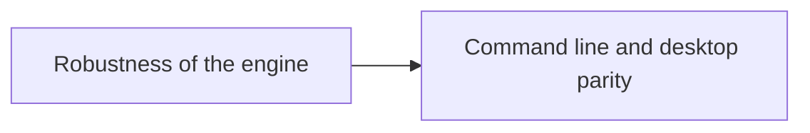

# Roadmap

Ideas accepted for ShogunAi's future, grouped by theme. This page is a direction, not a commitment to dates: each item becomes an OpenSpec change (`/opsx:propose`) when it's picked up, and its design is decided there. Once a change is archived, its item is removed from this page.

## Direction

ShogunAi is evolving from a desktop app that creates worktrees into **the worktree layer for any AI agent**: it prepares each worktree so it's ready to build, and gives you an overview of all of them, whoever created them. It doesn't embed terminals or run agents itself; Claude, Codex or any other agent keeps doing that, inside the worktrees ShogunAi prepares and oversees.

That direction is built in three layers:

| Layer | Role | What it brings |
|---|---|---|
| **Engine and CLI** | The foundation | Worktree provisioning defined in the repository (`.shogunai.json`) and a `shogun` command that the desktop app, agents and their hooks all use, including a per-worktree environment (reserved ports and variables) delivered to each agent's shell. **Available.** |
| **Control tower** | The view | The desktop app shows the state of every worktree, including the ones created by other tools, keeps them clean and follows changes as they happen. **Available.** |
| **Android, KMP and JVM** | The content | Provisioning for the stacks where a worktree is hardest to prepare: Gradle, local secrets, emulators and IDEs. **Started**: Gradle repositories show their daemons, can stop the idle ones and bound the memory and lifetime of the daemons agents start, Android repositories can give each worktree its own emulator, KMP and iOS repositories its own iOS simulator, and Xcode repositories see and clean up their DerivedData and share compilations between worktrees. |

It plugs into the tools that run agents rather than replacing them: Claude Code's worktree and session hooks, and [Herdr](https://herdr.dev), the terminal multiplexer for agents, whose worktrees a ShogunAi plugin provisions and where the desktop app opens a worktree with its environment and agent. **Available.**

## Planned

### Hardening after real use

A review of the whole project on 2026-10-19, after using it on real repositories, turned into six OpenSpec changes, already proposed in `openspec/changes/`:

- **Release hardening** (`release-hardening`): the macOS bundle version stays valid from 1.0 and 2.0 on, releases run the tests first, CI tests on Linux, macOS and Windows, releases publish `SHA256SUMS`, and the workflow holds least privilege with pinned actions.
- **Robustness of the engine** (`process-robustness`): cancelled commands stop, commands never wait for input, a failed creation removes its branch, corrupted local files are reported and kept, submodules work, and branches are deleted by one rule everywhere; cleanup never removes a worktree with a running agent.
- **Desktop fixes after the redesign** (`desktop-review-fixes`): no crash when a creation races a refresh, errors visible in every grouping, errors inside the removal dialog, and path edits in settings that keep unsaved changes.
- **Background refresh cost** (`background-refresh-cost`): the watcher pauses while the window is in the background and only checks the shown projects, with cheaper device reads (done).
- **Command line and desktop parity** (`cli-desktop-parity`): `shogun remove` and `shogun repair`, and in the app the provisioning state and "Provision" for worktrees created by other tools, plus the worktree's environment variables.
- **Docs and build hygiene** (`docs-hygiene`): missing docs, the Herdr plugin manifest test, compiler warnings, unused strings and dependencies, and ignore rules.

Follow-ups left out of those changes:

- Support for bare repositories with worktrees (the "bare clone" layout), which changes what the base repository and copying from it mean.
- Filesystem watchers instead of polling for Git metadata changes.
- Splitting `ProjectWorktrees.kt` and `ProjectSettingsView.kt` into smaller holders and sections.
- Build provenance attestations for release assets, and treating compiler warnings as errors once the build is clean.

### Guided onboarding demo

A first-run walkthrough built on the review done before merging the worktree layer: the app creates a throwaway sample repository with worktrees in every state, and opens an agent with a prepared prompt that walks the user through each feature (status, cleanup, provisioning, the CLI, hooks, environment and providers), one step at a time.

### Command-line output for scripts

- `shogun status --json` exists; the other `shogun` commands get a machine-readable output (`--json`) when a script needs it.

### Android, KMP and JVM provisioning

Provisioning for the stacks where a fresh worktree is furthest from building:

- `local.properties`, keystores and `google-services.json`.
- "Open in Android Studio" on the right worktree.
- Showing the emulators ShogunAi starts inside Android Studio's Running Devices window, as the ones Android Studio starts itself, so several of them can be arranged in one window. It needs a spike: Android Studio may embed an external emulator started with the options it uses itself.

### Choosing the base of a new worktree

`shogun new` and Claude Code's `WorktreeCreate` hook already start a new branch at the HEAD of the worktree they run in, and `shogun new --from <ref>` at any branch, tag or commit. The desktop app still starts it at the base repository's `HEAD`, so creating a worktree there from an up-to-date branch means going to another Git client first. Still planned:

- Pick the base branch (`develop`, `main`, …) when creating a worktree in the desktop app, with an optional `git fetch` beforehand.
- Create a worktree from a remote branch (`origin/...`), not only from local ones.

### Launching the agent and tools directly

Copying the launch command stays as the default, but the app could also open it directly with reliable, specific integrations instead of a generic terminal launch:

- Terminals: iTerm2 and Terminal on macOS, Windows Terminal, tmux and Zellij.
- Herdr's agent status (working, blocked, done) in each worktree row, read from its API, now that worktrees can be opened in Herdr.
- "Open in IDE" (VS Code, IntelliJ IDEA, Android Studio) and "Open folder".

### Multi-agent mode

Some users switch between AI agents on the same task, for example when one of them runs out of quota. A project would hold several agent commands instead of one (Claude, Antigravity, Codex, …), each with its default arguments, and the user would pick the agent when copying or launching the command. The current single-agent setup stays the default for users who don't need it.

### Polish after the interface redesign

Smaller findings from reviewing the redesigned interface end to end:

- A branch with no commits of its own shows as "merged into main" and sits in "Needs you"; it should read as not started.
- The save bar's "Discard" asks "Discard changes?" again; the button should be enough.
- The "Project settings" title doesn't name the project.
- The `link` and `hooks` fields of `.shogunai.json` aren't shown in a worktree's files section.
- The Android emulators view shows "—" in its rows and has no column labels.

### Desktop ergonomics

- Menu bar / system tray icon with recent projects and worktrees.

### Distribution

- Update check against GitHub Releases: the app notices a newer version and offers to download it (or points to `brew upgrade` when installed through Homebrew).

## Under exploration

### Integration with GitHub and task trackers

Creating a worktree from a GitHub issue or a tracker task (deriving the task id and title), and showing the pull request state of each branch (open, in review, CI failing, merged). The value is clear, but the integration model isn't yet: which providers, how to authenticate, and how much to rely on external CLIs such as `gh`. It needs more thought before becoming a change.

## Out of scope for now

### Running agents inside the app

ShogunAi doesn't embed terminals or manage agent sessions: agents and terminals already do that well. It focuses on the worktrees they work in.

### macOS signing and notarization

Left out for now: it requires a paid Apple developer program. Until then, the README explains how to open the unnotarized app.
